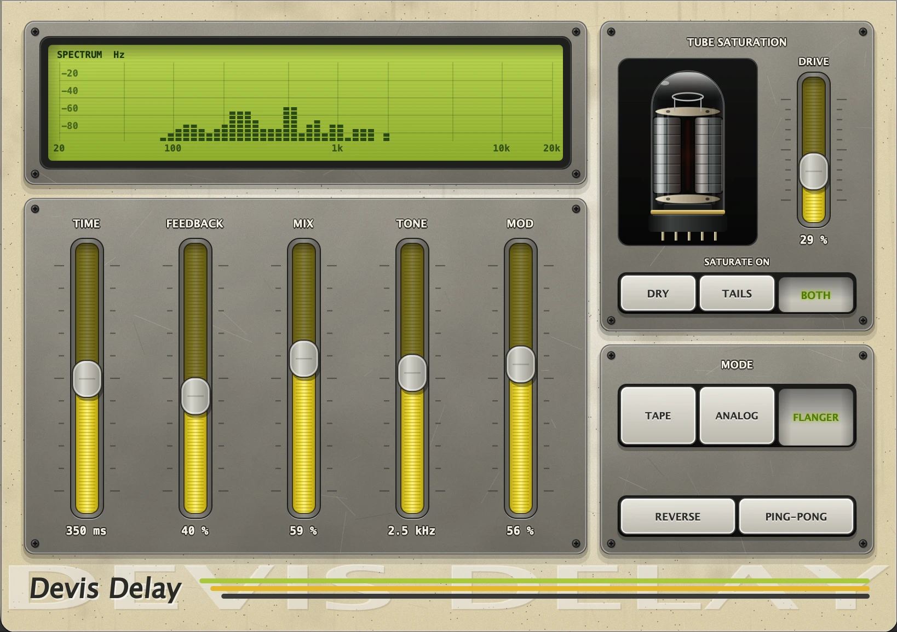

# Devis Delay

A VST3 delay plugin built with JUCE: tape / analog / flanger repeats, reverse delay, tube saturation, live spectrum and a glowing 12AX7 that reacts to how hard you play.



## Build (macOS)

```bash
git clone https://github.com/denissavishchev/Devis-Delay
cd Devis-Delay
git clone --depth 1 --branch 8.0.8 https://github.com/juce-framework/JUCE.git JUCE
cmake -B build -DCMAKE_BUILD_TYPE=Release
cmake --build build --target SimpleDelay_VST3
```

The plugin appears in `build/SimpleDelay_artefacts/Release/VST3/Devis Delay.vst3`; copy it to `~/Library/Audio/Plug-Ins/VST3/`.
